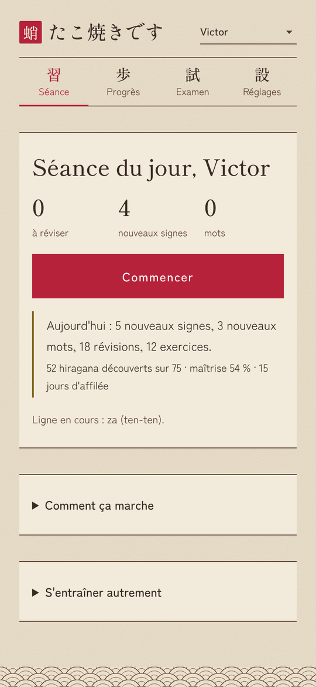
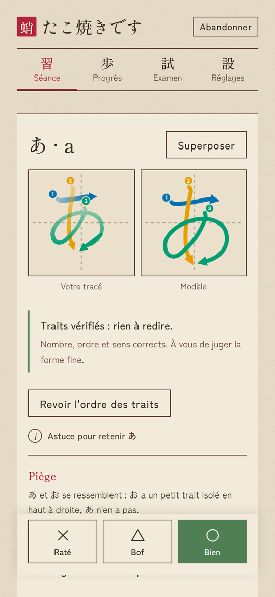
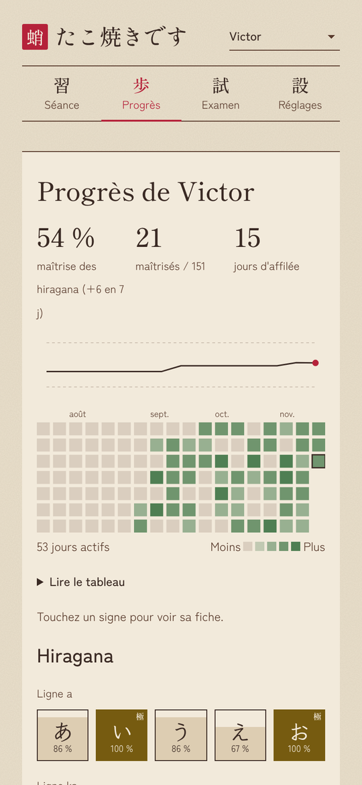
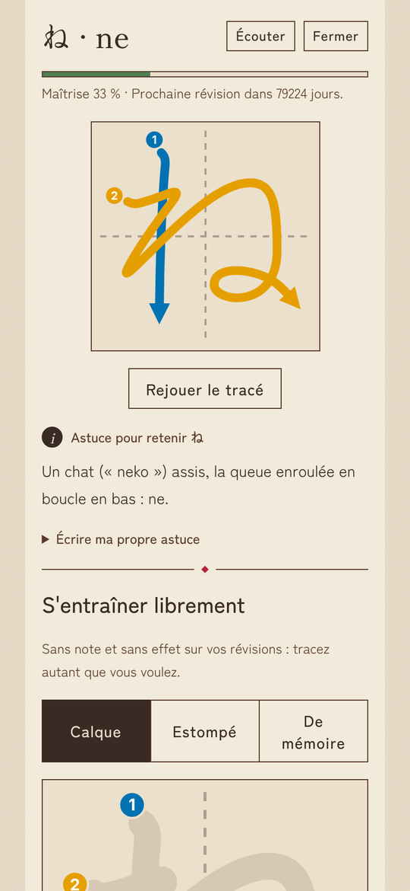

# たこ焼きです · Takoyaki desu

**Apprendre à lire et écrire les kana japonais en les écrivant de mémoire.**
Une appli web à installer sur son téléphone : hors ligne, sans compte, sans publicité, et rien ne quitte l'appareil.

[](https://github.com/VictorMusta/Takoyaki-desu/actions/workflows/deploy.yml)
[](https://github.com/VictorMusta/Takoyaki-desu/actions/workflows/quality.yml)
[](LICENSE)

**[→ Essayer l'appli](https://victormusta.github.io/Takoyaki-desu/)**

<p>
  
  
  
  
</p>

## La méthode

Reconnaître un signe ne suffit pas pour savoir l'écrire. Ici, on **écrit chaque signe de mémoire**, on le compare au modèle, et la répétition espacée le fait revenir juste avant qu'on l'oublie.

1. **Découvrir** : le signe, son ordre des traits animé, puis un pochoir, un pochoir estompé et la page blanche.
2. **Rappeler** : écrire de mémoire. L'appli **vérifie elle-même** le nombre, l'ordre et le sens des traits, sans tenir compte de la taille ni de la position. Elle accepte les variantes manuscrites courantes (き en 3 traits, さ en 2) et entoure le trait fautif.
3. **Se noter** : Raté, Bof ou Bien. La vérification ne note jamais à votre place : elle bloque seulement « Bien » sur une vraie erreur, et « Je pense que c'est juste » permet de la contredire.
4. **Revoir** au bon moment : SM-2 simplifié. Une ligne du tableau s'ouvre quand 80 % de la précédente tient trois jours.

## Ce qu'on y trouve

- **151 signes** : hiragana complets (base, ten-ten, maru, petits signes), puis katakana avec la barre ー. Chaque signe a son astuce mnémotechnique, des mots d'exemple et une fiche (5 polices, son jumeau dans l'autre écriture).
- **262 mots utiles**, du quotidien et du voyage (でんしゃ, きっぷ, コンビニ…). Un mot s'ouvre dès que ses signes sont appris. Les romaji s'effacent quand un signe est bien acquis.
- **Exercices** : reconnaître les signes, lire des mots, écrire des mots (clavier ou main), phrases, proverbes, et vrais textes vus au Japon (panneaux, menus, stèles).
- **Progrès** : maîtrise par écriture, courbe sur 30 jours, calendrier d'activité, fiche de chaque signe avec traçage libre.
- **Examen strict**, pour vérifier que ses propres notes sont honnêtes.
- **Profils** : plusieurs personnes sur un même téléphone.
- **Sauvegarde** : « M'envoyer ma sauvegarde » ouvre le partage avec le fichier en pièce jointe, et un rappel hebdomadaire s'affiche. La restauration montre la date et le contenu avant de remplacer quoi que ce soit.
- **Confort** :
  - trait pinceau ou simple ;
  - vibrations discrètes ;
  - thème clair et sombre ;
  - « Quoi de neuf ? » après chaque mise à jour ;
  - mises à jour automatiques, jamais au milieu d'une séance.

## En japonais, pour les testeurs

L'interface existe aussi en japonais (Réglages › Apparence › 日本語). Le français reste la langue par défaut, et on passe de l'une à l'autre au même endroit. Dans « Faire tester en japonais » (Réglages › Un avis ?), un écran en japonais invite une personne japonaise à essayer : sur ce téléphone, dans un profil « テスター » séparé, ou sur le sien grâce à un QR code. Le bouton « Remarque », présent sur chaque écran, enregistre ses retours écrits, puis les envoie tous d'un coup.

Côté code, le français reste la seule source. `scripts/i18n_extract.mjs` liste chaque texte de l'interface dans `src/i18n/strings.json`, `src/i18n/ja.ts` les traduit, et une couche de traduction réécrit l'écran à la volée. Les tests échouent si un texte n'est pas traduit. Le contenu d'apprentissage n'est pas traduit, mais chaque sens de mot affiche son écriture japonaise habituelle à côté du français. Les kanji de l'interface japonaise sont dans des polices à part, téléchargées seulement quand l'appli est en japonais.

## Confidentialité

L'appli n'a ni compte, ni serveur, ni mesure d'audience, ni cookie, ni outil tiers. Les polices sont livrées avec l'appli. La progression vit uniquement dans le navigateur. Des données ne partent que si l'utilisateur le décide : une sauvegarde qu'il s'envoie, un retour par mail ou un ticket GitHub. Le détail est dans l'appli, sous Réglages › Confidentialité.

## Installer sur son téléphone

Ouvrir [le lien](https://victormusta.github.io/Takoyaki-desu/) puis :

- **Android (Chrome)** : menu ⋮ › « Ajouter à l'écran d'accueil » ;
- **iPhone (Safari)** : bouton Partager › « Sur l'écran d'accueil ».

## Développement

Le projet est en TypeScript strict, avec Vite et vite-plugin-pwa. Il n'utilise aucun framework d'interface : les écrans sont des modules qui construisent le DOM.

```bash
npm install
npm run dev     # serveur local
npm test        # tests unitaires (Vitest)
npm run build   # vérification des types + build dans dist/
npm run e2e     # parcours d'écrans (Playwright + axe), sur le build
```

| Dossier | Contenu |
| --- | --- |
| `src/core` | Logique pure et testée : planification, vérification des traits, exercices, vocabulaire, migrations des données, sauvegarde |
| `src/data` | Tracés des kana (KanjiVG), astuces, mots, textes, journal des nouveautés |
| `src/ui` | Canevas d'écriture, rendu pinceau, modèles SVG, calendrier, vibrations, fenêtres |
| `src/views` | Écrans : séance, comparaison, exercices, progrès, examen, réglages |
| `scripts` | `extract_kana.py` (tracés depuis KanjiVG), `subset_fonts.py` (polices réduites aux caractères utilisés) |
| `e2e` | Parcours d'écrans à 320 et 393 px, en thème clair et sombre |
| `deploy` | Hébergement sur un VPS derrière Caddy (optionnel) |

**Qualité.**

- Plus de 60 tests unitaires couvrent notamment :
  - la planification et la vérification des traits sur les 151 signes ;
  - un test aléatoire qui génère des centaines d'exercices à 5 stades d'apprentissage ;
  - les migrations de données sur de vraies sauvegardes ;
  - la couverture des polices.
- Les parcours d'écrans font échouer le contrôle sur une erreur de script, un défilement horizontal ou un problème d'accessibilité sérieux (contraste compris).

**Données.** Le format enregistré porte un numéro de version. `src/core/migrations.ts` fait monter les anciennes données étape par étape, au lancement comme à l'import. Les données d'une version plus récente ne sont jamais modifiées, et celles qui sont illisibles sont mises de côté au lieu d'être écrasées.

**Publier une version.**

1. Monter `version` dans `package.json`.
2. Ajouter l'entrée correspondante, en mots simples, dans `src/data/changelog.ts` (un test vérifie la concordance).
3. Pousser sur `main`.

## Déploiement

Chaque push sur `main` lance les tests et le build, puis publie sur GitHub Pages. Le workflow « Qualité » tourne à côté sans retarder la mise en ligne. Pour héberger aussi sur un VPS, voir [`deploy/README.md`](deploy/README.md).

## Crédits et licences

- Code : MIT, voir [`LICENSE`](LICENSE).
- Tracés et ordre des traits : [KanjiVG](http://kanjivg.tagaini.net), © Ulrich Apel, sous licence [CC BY-SA 3.0](https://creativecommons.org/licenses/by-sa/3.0/). `src/data/kana.json` en est dérivé et reste sous cette licence.
- Polices : Shippori Mincho B1, Zen Kaku Gothic New, Klee One, Shippori Mincho, Yuji Syuku et Zen Maru Gothic, sous licence [SIL Open Font License](https://openfontlicense.org), réduites aux caractères utilisés par l'appli.
